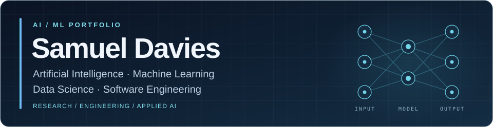

  <a href="https://www.linkedin.com/in/samuel-davies-b17b5228a/">LinkedIn</a>
  &nbsp;·&nbsp; MSc Artificial Intelligence
  &nbsp;·&nbsp; First-Class BEng Software Engineering

## About me

I'm an aspiring AI and Machine Learning Engineer with postgraduate research experience in artificial intelligence and a strong foundation in software engineering.

I have completed my MSc studies in Artificial Intelligence at the University of Bath (final result pending), following a First-Class BEng in Software Engineering at Swansea University.

My interests include computer vision, applied machine learning, data science and constraint-aware optimisation. I'm particularly interested in developing intelligent systems that combine rigorous experimentation with reliable software engineering.

I'm open to graduate and early-career opportunities in AI, machine learning and data science.

## Technical toolkit

| Area | Technologies and techniques |
| :--- | :--- |
| AI & machine learning | Python, scikit-learn, OpenCV, search and optimisation |
| Data science | NumPy, pandas, SQL, Jupyter, statistical analysis |
| Software engineering | Java, Git, Flask, JavaScript, React |
| Cloud & development | AWS |

## Education & certification

| Qualification | Institution |
| :--- | :--- |
| MSc Artificial Intelligence — First-Class Distinction (74% Overall) | University of Bath |
| BEng Software Engineering — First-Class Honours (86% overall) | Swansea University |
| AWS Certified AI Practitioner | Amazon Web Services |

## Currently developing

- PianoVision and practical computer vision techniques
- Machine learning mathematics and algorithm implementations
- End-to-end ML engineering, including model evaluation and deployment

---

  <a href="https://www.linkedin.com/in/samuel-davies-b17b5228a/">Connect with me on LinkedIn</a>

